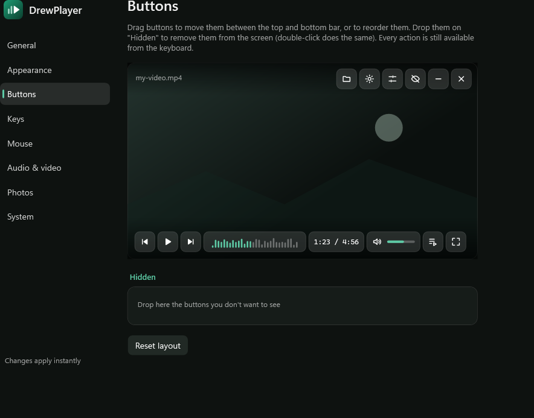
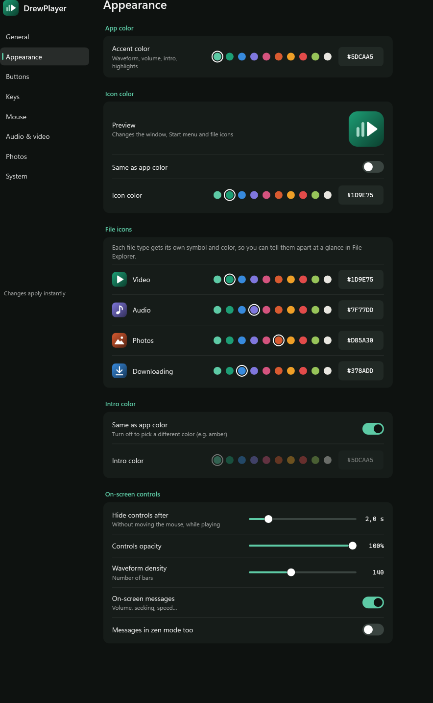

<p align="center">
  
</p>

<h1 align="center">DrewPlayer</h1>

<p align="center">
  A lightweight, good-looking media player for Windows that you can customize down to every button.<br>
  Video, music and photos in one window, powered by <a href="https://mpv.io">mpv</a>.
</p>

<p align="center">
  
</p>

---

## Why

The built-in Windows player is heavy, slow to open and hard to bend to your habits.
DrewPlayer opens straight into the video, gets out of the way while you watch, and lets you
decide what every key, click and on-screen button does — without ever editing a config file.

## Features

- **Plays practically everything** — MP4, MKV, AVI, MOV, WebM, HEVC, AV1, MP3, FLAC, WAV, Opus… plus photos (JPG, PNG, WebP, GIF, HEIC, AVIF). Decoding is done by libmpv/FFmpeg.
- **Clean UI that disappears** — controls fade out after a couple of seconds; *zen mode* hides everything, cursor included.
- **Fully customizable from a real settings window** — rebind any key or mouse button, choose how far each seek jumps, colors, timings, and drag & drop the on-screen buttons on a live mini-preview of the player.
- **Tabs** — open several files in one window instead of a pile of windows.
- **Watch while downloading** — open a `.crdownload` / `.part` file and it keeps playing as the download grows.
- **Previous / next file** in the same folder, following the sort order you see in File Explorer.
- **Photo viewer** — wheel to zoom, drag to pan, arrows for the next photo.
- **Brightness control**, playback speed, subtitles and audio tracks, frame stepping, screenshots.
- **Your colors everywhere** — accent color, app icon and per-type file icons (video, audio, photo, download) so you can tell files apart in Explorer at a glance.
- **Proper Windows citizen** — single instance, file associations without admin rights, opens directly in fullscreen if you want, no flicker on open or close.

<p align="center">
  
  
</p>

## Performance

DrewPlayer is a thin WPF shell around **libmpv**, the engine behind mpv — the heavy lifting
(demuxing, decoding, scaling, rendering) happens in native code, on the GPU whenever possible.

| | |
|---|---|
| **Hardware decoding** | D3D11VA by default (H.264, HEVC, VP9, AV1 — whatever your GPU supports), automatic CPU fallback |
| **CPU while playing 1080p H.264** | ~2 % of total CPU |
| **Memory** | ~300 MB working set while playing (mostly libmpv's decoder, GPU interop and read-ahead buffers) |
| **Launch to first frame** | ~1.7 s cold, intro disabled; with the intro on, the player warms up behind it |
| **App size** | ~0.6 MB for DrewPlayer itself + ~116 MB for libmpv (all codecs included) |

<sub>Measured on an Intel Core i5-8400 + GeForce GTX 1050 Ti, Windows 11, playing a 1920×1080 30 fps H.264 file (36 Mbit/s), Release build.</sub>

**About quality:** the file is never re-encoded. Every frame is decoded at its original resolution
(480p stays 480p, 4K stays 4K) and only scaled to fit the window or the screen. An optional
*High quality scaling* setting switches mpv to sharper (EWA Lanczos) scalers.

## Getting started

### Requirements

- Windows 10 or 11, 64-bit
- [.NET 8 Desktop Runtime](https://dotnet.microsoft.com/download/dotnet/8.0) (the SDK if you build from source)

### Build and install

```powershell
git clone https://github.com/arCt1cX/drewplayer.git
cd drewplayer

# 1. download libmpv (the playback engine, ~30 MB download) into lib\
powershell -ExecutionPolicy Bypass -File scripts\get-libmpv.ps1

# 2. build a Release version and install it to %LOCALAPPDATA%\Programs\DrewPlayer (+ Start menu shortcut)
powershell -ExecutionPolicy Bypass -File scripts\install.ps1
```

For development, `dotnet run --project src/DrewPlayer` works too once `lib\libmpv-2.dll` is in place.

### Make it the default player

```powershell
powershell -ExecutionPolicy Bypass -File scripts\register.ps1
```

or **Settings → System → Set as default player** inside the app. This registers DrewPlayer for
video, audio and photo files (current user only, no admin rights) and opens *Windows Settings → Default apps*.
Windows does not let apps make themselves the default, so the last click is yours: pick DrewPlayer
for the file types you want. `scripts\unregister.ps1` undoes everything.

## Controls

Everything below can be changed in **Settings → Keys / Mouse**.

| Key | Action | | Mouse | Action |
|---|---|---|---|---|
| `Space` | Play / pause | | Click | Play / pause |
| `←` `→` | Seek 10 s | | Double click | Fullscreen |
| `Shift` + `←` `→` | Seek 30 s | | Right click | Play / pause |
| `Ctrl` + `←` `→` | Seek 2 min | | Middle click | Zen mode |
| `↑` `↓` | Volume | | Wheel | Volume (zoom on photos) |
| `F` / `Esc` | Fullscreen / exit | | Side buttons | Seek 10 s |
| `Z` | Zen mode | | Drag | Move the window |
| `Page Up` / `Page Down` | Previous / next file | | | |
| `Ctrl+T` / `Ctrl+W` / `Ctrl+Tab` | New / close / next tab | | | |
| `I` | File info (codec, resolution, GPU decoding) | | | |
| `Ctrl+,` | Settings | | | |

## Configuration

All settings live in `%APPDATA%\DrewPlayer\settings.json` and are edited from the settings window;
changes apply instantly. Power users can drop an `mpv.conf` in the same folder to pass any
[mpv option](https://mpv.io/manual/stable/) (shaders, subtitle styling, filters…), and any key can
run a raw mpv command via the `mpv <command>` action.

## Project structure

```
src/DrewPlayer/
├── App.xaml(.cs)          startup, single instance, command-line modes
├── Core/                  libmpv wrapper, Win32 interop, file associations, folder ordering
├── Settings/              settings model + storage, bindable actions, key chords, button layout
├── Graphics/              stroke icons and the runtime icon generator
└── Windows/               video window, UI overlay, settings window, intro
scripts/                   get-libmpv, install, register/unregister, icon generator
```

The video is rendered by mpv into a native child window; since WPF cannot draw on top of it,
the whole UI lives in a transparent overlay window kept glued to the video window.

## Known limitations

- Windows only.
- The seek bar waveform is decorative (stable per file, not computed from the audio).
- An MP4 that stores its index at the end of the file cannot be played until the download completes (MKV/WebM and "fast-start" MP4s work fine).

## Credits & license

- Playback engine: [mpv / libmpv](https://github.com/mpv-player/mpv), Windows builds by [shinchiro](https://github.com/shinchiro/mpv-winbuild-cmake).
  libmpv is **not** included in this repository; it is downloaded by `scripts/get-libmpv.ps1` and is
  licensed under its own terms (GPLv2+/LGPLv2.1+, depending on the build).
- DrewPlayer's own source code is released under the [MIT License](LICENSE).
